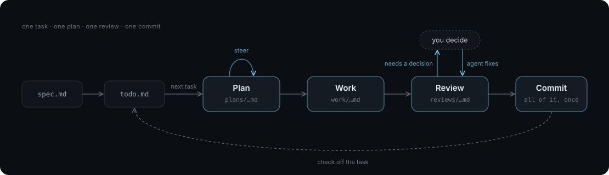

# An Agentic Development Workflow

> The ability to simplify means to eliminate the unnecessary so that the necessary may speak.<br>— Hans Hofmann

This workflow assumes the developer roughly knows what they want to build, is prepared to make the architectural decisions, cares about the code.

There are no agent swarms here -- no worktrees. This is just you, an agent harness, your code, a couple files, and three agent skills; working carefully on one thing at a time.

Don't forget:

- This stuff changes _fast_. This is my workflow today. It probably won't be my workflow tomorrow. Stay nimble.
- Do what works for you, your team, and your project.
- Don't believe the hype. Nobody has this figured out yet. Use agents to write code, read that code, and form your own opinions.

## Overview

For each task, the agent writes a plan, implements it, and reviews the changes. You review the plan and make any decisions the agent raises. The plan, code, work log, and review are committed together, then the task is checked off.



## The Workflow

### 1. Plan ([`kplan/SKILL.md`](https://github.com/kkestell/skills/blob/main/kplan/SKILL.md))

```
/kplan the next task in agents/todo.md
```

The plan skill takes the next task in `todo.md`. The agent explores the codebase, works through any open design decisions with you, and writes an implementation plan to `agents/plans/`.

Planning upfront forces the agent to confront edge cases before writing code, lets you use a cheaper, faster model for the implementation, and lets you steer the design before bad code is written.

### 2. Work ([`kwork/SKILL.md`](https://github.com/kkestell/skills/blob/main/kwork/SKILL.md))

Once the plan looks right, the work skill takes over. The agent implements the plan, runs the checks, and writes a work log to `agents/work/` recording how the change was verified, where it departed from the plan, and any surprises it ran into.

### 3. Review ([`kreview/SKILL.md`](https://github.com/kkestell/skills/blob/main/kreview/SKILL.md))

After the implementation is done, the review skill checks it. The agent reviews the changes against the plan, fixes trivial issues directly, and asks you to decide on anything non-trivial. It writes the review to `agents/reviews/` and commits the plan, code changes, work log, and review together.

## Project Layout

Start with three files:

```text
.
├── AGENTS.md
└── agents/
    ├── spec.md
    └── todo.md
```

`AGENTS.md` sits at the root of the repository and holds the project's standing instructions for the agent: what the project is, how to run the checks, and a few rules about style, documentation, and communication.

Everything else lives in `agents/`, which keeps the workflow's files together and out of the way of the code:

- **`spec.md`** describes what the project does from the outside: its behavior, its integrations with other systems, and the invariants it must keep. It's the shared definition of what's being built, and tasks are drawn from it.
- **`todo.md`** is the backlog, a list of milestones broken into session-sized tasks. It tracks what comes next.
- **`plans/`** holds one implementation plan per task. Writing the plan before any code lets you steer the design while it's still cheap to change.
- **`work/`** holds one work log per task, recording how the change was verified, where it departed from the plan, and decisions made along the way.
- **`reviews/`** holds one code review per task, with the findings and how each was resolved.

Some projects might also need an `agents/architecture.md`, covered below.

### `AGENTS.md`

> The more you tighten your grip, Tarkin, the more star systems will slip through your fingers.<br>— Princess Leia Organa

Keep `AGENTS.md` short. A model has limited attention, and you want it thinking about your code, not your workflow.

Start with a few rules and add them when you see recurring problems. Revisit them when you change models; a workaround that helped one model may be unnecessary for the next.

Here's an example:

````markdown
# Project

Describe your project in one sentence.

## Commands

- `npm run lint` runs every check.
- ...

## Workspace

```text
.
├── AGENTS.md
├── agents/
│   ├── spec.md           # Project behavior, integrations, and invariants
│   ├── architecture.md   # Implementation constraints and design decisions (optional)
│   ├── todo.md           # Milestones and tasks
│   ├── plans/            # Implementation plans
│   ├── work/             # Work logs and verification results
│   └── reviews/          # Code reviews and finding resolutions
├── src/
└── tests/
```

## Style

- Do less. Keep correct code simple, idiomatic, and cheap to change.
- Give each concern a clear boundary and each lifecycle one owner.
- Solve the actual problem. Every addition must justify its complexity; producing more code is not a goal. When both a simple solution and a general solution work, choose the simple one and wait for evidence before generalizing.
- Test observable behavior. Use a small number of representative examples and meaningful regression tests for actual bugs.

## Documentation

- Give each fact a single source of truth.
- The code and its comments describe the implementation. Git history records changes.
- Most code needs no comments. Most changes need no documentation updates.
- Do not create new documentation files or sections unless requested.
- Code, comments, and test names describe the project in its own terms. Never mention roadmap milestones, ticket numbers, plans, or other work records in them.

## Communication

- Describe things directly, clearly, and plainly. Lead with the main point, then add detail as needed.
- Avoid jargon, invented terms, and shorthand. Never mix definitions or overload terms.
- Explain what changed and how it was verified. Be short. Say the thing and stop.
````

Keep documentation for things the code can't explain. Agents often generate prose that restates the implementation, adding files to maintain and context to read. They can read the code directly.

### `agents/spec.md`

Start with `agents/spec.md`, written by hand or with the agent. It defines what the project does, how it interacts with other systems, and the rules its behavior must satisfy. Keep implementation details in the code.

Write enough to guide the first tasks, then refine the spec as you build and learn.

### `agents/todo.md`

Once some or all of the spec is written, it's broken into milestones and tasks in `todo.md`. It's just a simple two-level list:

- **Milestones:** A large feature or subsystem.
  - **Tasks:** Session-sized units of work that are implemented in sequence, reasonably self-contained (the project builds after each task), and meaningfully testable.

```markdown
# Todo

- Tasks API
  - [x] Create and fetch tasks in memory
  - [x] List tasks and filter them by status
  - [ ] Update and delete tasks
- Persistence
  - [ ] Add a PostgreSQL task store behind the in-memory store's interface
  - [ ] Run the service against PostgreSQL, reading `DATABASE_URL` at startup
```

Check off tasks as you finish them to track progress within each milestone. Milestones don't have checkboxes: remove them from `todo.md` when all their tasks are done. This keeps the backlog focused on upcoming work; the plans, work logs, reviews, and commit history preserve the record of completed work.

### `agents/architecture.md` (optional)

`architecture.md` documents the project's implementation constraints and the reasoning behind key design decisions. It covers dependency boundaries, ownership of shared state and resources, and how work is split across threads or processes.

This file can easily accumulate cruft, so keep it focused on high-level architecture. Do not let it become a running commentary on the code. Most code changes shouldn't touch it; update it only when the architecture changes. Include it only when the project needs these rules and decisions documented.

## Models and harnesses

The [skills](https://github.com/kkestell/skills) work with Claude Code, Codex, and OpenCode. Choose a model for each step, and use a different model for review to get another perspective on the code.

## Sessions

The spec, to-do, plan, and work can all happen in a single session, as long as you keep an eye on the context window. Other times it makes sense to split things up: the spec and to-do in one session, then plan, work, and review each in a fresh session.

The trade-off is that the agent has to reorient itself at the start of every fresh session. Prefix caching makes long sessions much, much cheaper than they look.

## Examples

Here are a few projects built with this workflow. Their repositories show what the generated plans, work logs, reviews, and commit histories look like in practice:

- **[Ox](https://github.com/kkestell/ox)**: An ACP-native coding agent in Go, with an ACP server and a terminal UI.
- **[Willow](https://github.com/kkestell/willow)**: A small, statically typed language with Python-like syntax that compiles to Lua and runs on LuaJIT.

## Claude Code Tips and Tricks

### No Free Advertising

Disable Claude's attribution in commits and pull requests:

```json
{
  "includeCoAuthoredBy": false
}
```

See the [attribution settings](https://code.claude.com/docs/en/settings-reference#includecoauthoredby).

### Spinner Verbs

`"mode": "replace"` replaces the default spinner verbs with your own. Use `"append"` to keep the defaults too. Here's my full list:

```json
{
  "spinnerVerbs": {
    "mode": "replace",
    "verbs": [
      "DISTILLING A CHINESE MODEL",
      "PERPETUAL MOTION IS POWERED BY CUBIC WISDOM",
      "RELOCATING THE EYES OF THE FLOUNDER FISH",
      "GENE RAY IS NOT A CRACKPOT",
      "BE THREE FEET BEHIND YOUR HEAD"
    ]
  }
}
```

### Disable Artifacts

Turn off Claude Code's Artifact tool:

```json
{
  "enableArtifact": false
}
```

See [Disable artifacts](https://code.claude.com/docs/en/artifacts#disable-artifacts).
